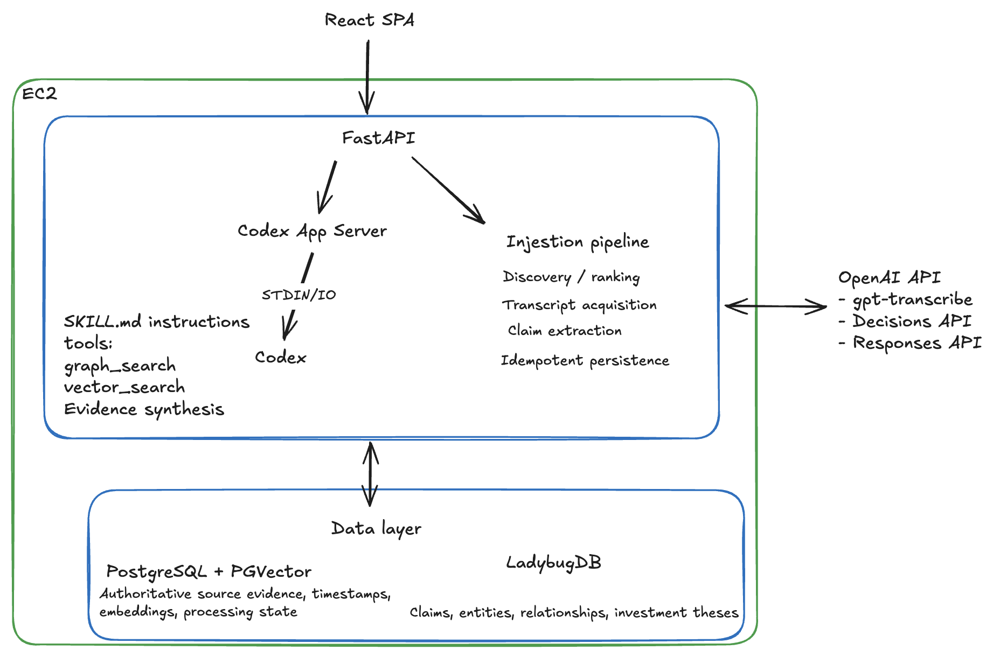
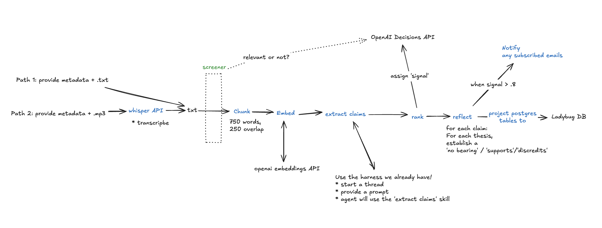

# Podcast Analyst

## Product vision:
A virtual coworker (1 per team) that you can assign the time-consuming job of listening to podcasts for claims relevant to your thesis. Target audience: analysts. 

> User: "Keep an eye on semiconductor podcasts. I'm particularly bullish on optical interconnects."

`Agent: "Got it. I'll monitor those sources and let you know if I encounter evidence that challenges your thesis."`

> Two days later...

`Agent (email): "I ingested a new podcast from SemiAnalysis Weekly. The guest made two high-signal claims that could undermine your thesis about optical interconnect adoption. Here's the evidence:"`

> User: navigates to the web app. "Interesting. How does that compare to what other executives have said? Does it discount any of my other thesis or support them?"

`Agent: Retrieves related evidence, traverses relationships between companies, claims, and speakers, and produces a cited synthesis.`

## How does this work? 30,000 foot view:
* Codex harness in a VM, fronted by a FastAPI server. Armed with a few good tools and a postgres / pgvector + ladybugDB graph database. Ingestion pipeline is just python using the same API.

## Tech stack
Engineering tenants: 1) keep the app simple as possible 2) minimize # of moving parts 3) prefer boring, battle-tested tech 4) don't overengineer for a small little unproven MVP product - but ensure scaling is easy
* UI: React + Vite chat UI
* Back end: FastAPI API, and a local Codex App Server harness running in a single process
* responses stream from codex to fastAPI over STDIN/OUT, then from FastAPI to the UI via SSE. 
* Postgres / PGVector for relational storage & embedding storage. LadybugDB for the graph database. 
* OpenAI API for the AI stack: text-embedding-3-large (passage -> vector embedding), gpt-transcribe (audio transcription), Decisions API (ranking and relevancy detection), and LLM inference (agent harness driver)
* Deployed on AWS: a single EC2 + a single Docker-compose. SES for email alerts. 
* Infrastructure as code (AWS CDK) for easy, fast, reproducable iterative deployments via command line. 
* AWS SSM for rapid container deployments to any environment, and logs retrieval for debugging

## Software design
Design priorities: *Simple data model*, Clear & well defined abstractions, and logical component / class heirarchy. Goal: an elegant and small piece of software that is easy to understand, modify, and maintain, while delighting users. 
* 1 off-the-shelf agent harness does everything: serves *both the chat experience, the claim extraction / ingestion pipeline, and writes email alerts*. No airflow, no lambda / AWS step functions, no microservice sprawl. We chose Codex App Server instead of building a new agent framework. We get tool orchestration, conversation management, and web search all for free
* the core ingestion logic is just a straightforward sequence of functions. Every step is atomic, durable (via Postgres) composable and swappable. no custom workflow DAGs, task queues, step registries, dependency injection frameworks, or elaborate inheritance hierarchies. All operations are idempotent so retries are simple to reason about.
* No over engineered RAG pipeline: just give the agent powerful tools, and a small set of good instructions - then get out of its way and let it work its magic.
* No complex pipeline for 'signal assessment'. No from-scratch ML models (I was tempted not gonna lie). 1 OpenAI Decisions API call gets the job done for MVP.
* Single source of truth: postgres. That's it. the Graph is just a projection, not a competing source of truth
* Avoid feature creep at all costs: wherever possible, just let the agent do the work that would otherwise require a bunch of new UI elements. Example: choose "subscribe to the a16z podcast" over a form that you make the user fill out. Just give the agent a tool (a few LOC) instead of a few hundred LOC for a new FE/BE feature. Every feature has to earn its right to exist by providing a ton of value to our end user: the analyst. 

## Features to consider in the future
* a novelty / non-consensus axis on the 'signal' measure. If a claim is determined to be unique or novel or inconsistent with other claims, that is especially interesting to an analyst, and it should boost its signal. Didn't have time to implement this one since it would make the claim ingestion pipeline a lot more time consuming / complex.
* guest credibility as a property of the speaker rather than each claim. Some guests are just more credible than others. That should be reflected in signal for claims made by them. 
* Other data types besides podcasts. RSS feeds are versatile so things like blog posts would be easist, but the data model also supports all kinds of live content, given we can find a way to retrieve it. CNBC / TV show streams, perhaps? 

## "Ok this is great - how do we scale this company wide?"
* Security would have to be the #1 priority - Integrate an Oauth provider for SSO or use AWS Cognito to ensure 2FA is implemented and robust. 
* Everything is in a single EC2... let's just say that doesn't scale. Good news is that the whole app is in a single docker-compose. We have to switch from a single EC2 to a fleet of containers - a kubernetes service would do the trick. AWS EKS offers managed k8s that would make this trivial. 
* The postges table and graph DB are sitting right inside the same docker image as the server. Migrate them out into their own managed services - AWS RDS / AWS Neptune are managed options that would suit nicely for a fast migration. 
* Monitoring. Set up AWS Cloudwatch for proper logging so that you don't have to use the AWS CLI to see the logs from your service. Set up a proper dashboard with graphs showing production traffic, 5xx/4xx %, latency & response time, etc etc. Set up alarms so if the health checks start failing, you get a text / phone call. 
* CI/CD: set up a real pipeline, like Jenkins or AWS CodePipeline.

## Cost
* The app is inexpensive to run. Each audio ingestion costs roughly $0.25 on average. The agent LLM is gpt-6-luna, which costs 10 cents per million tokens in / 50 cents per million tokens out. Decisions API is so cheap it can be rounded down to 0 (~1 cent per podcast ingestion)

## Ingestion pipeline
* See the 'how it works' page of the app. High level overview below:

## System design tradeoffs
* Use off the shelf open source Codex App Server instead of building a new agent framework. Gained: Mature agent loop, tool orchestration, conversation management, and web search all for free. Lost: extra dependency, and we tied the front end code to their JSON-RPC protocol for event streaming. Would make it hard to swap to something like pi.
* Simple, sequential ingestion pipeline instead of an orchestration framework like airflow. Gained: Easy-to-understand execution flow, straightforward debugging, minimal dependencies. Cost: no parallel processing or workflow scheduling. 
* Dynamic tools instead of MCP servers: Gained: simplicity - only a few LOC per tool. Lost: portability, observability, reuse of tool implementations.
* One Codex extraction thread per episode instead of independent LLM calls per passage. Gained: simplicity. Lost: cost, less deterministic than a more structured pipeline.
* Embedded LadybugDB instead of a standalone graph service. Gained: No additional service to deploy, operate, authenticate, or monitor. Lost: scalability 
* Single EC2 instance instead of distributed infrastructure. Gained: Extremely fast development and deployment, inexpensive infrastructure, simple operational model. Lost: Single point of failure and limited concurrency, scalability. 
* RSS monitoring instead of YouTube scraping: Standardized episode discovery, reliable metadata, transcript/audio enclosures. Lost: can't transcribe arbitrary URLs
* Persisting audio in PostgreSQL. We store uploaded MP3 bytes in PostgreSQL rather than introducing S3 as another storage dependency.

## How to run the app locally
Open the repo in vscode. The easist way to run the app is via the preconfigured run configurations. 
Use **serve built app** on port 8000, **run full stack
app** for HMR development, or **serve front end** when the backend is already running.

## Software development process
* Codex and claude code were used for implementation and deployment, also for monitoring and debugging. Claude Design was used for app layout and styling.

## Watching podcasts (RSS)

Ask the chat to *"Start watching the Dwarkesh Podcast."* Codex follows the
`register-watcher-on-podcast` skill: it web-searches for the official RSS feed and calls
`register_rss_to_watcher`. The backend then fetches and validates the feed (http(s) only, public
hosts only, timeouts and size caps) and saves it in `watch_sources`.
- **First run:** only the newest episode at registration is ingested; the archive is not backfilled.
- **Polling:** every minute the watcher checks whether the pipeline is idle (no pending or running job).
  When it is, it fetches the feeds not checked for an hour and queues **one** new episode, compared by
  RSS GUID against `episodes`. It uses the feed's transcript (plain text, WebVTT, or SRT) if there is
  one, otherwise the audio enclosure, through the existing ingestion path. Its progress appears
  in the page's status bar, like an upload's.
- **Limitations:** no UI to remove feeds (the left-hand cabinet lists them); episodes that drop out of a feed before they are
  queued are missed; video-only feeds and HTML/JSON transcripts are not supported; and a failed
  job is not retried automatically.

Details: [RSS watchers](docs/etl_design.md#rss-watchers).

## Documentation

- [Local setup and VS Code run configuration](docs/local_development.md)
- [Local Codex chat setup](docs/local_codex_chat.md)
- [Docker and AWS deployment](docs/aws_deployment.md)
- [Longer-term deployment plan](docs/devops.md)
- [High-level design](docs/high_level_design.md)
- [Database design](docs/database_design.md)
- [Ingestion pipeline design](docs/etl_design.md)
