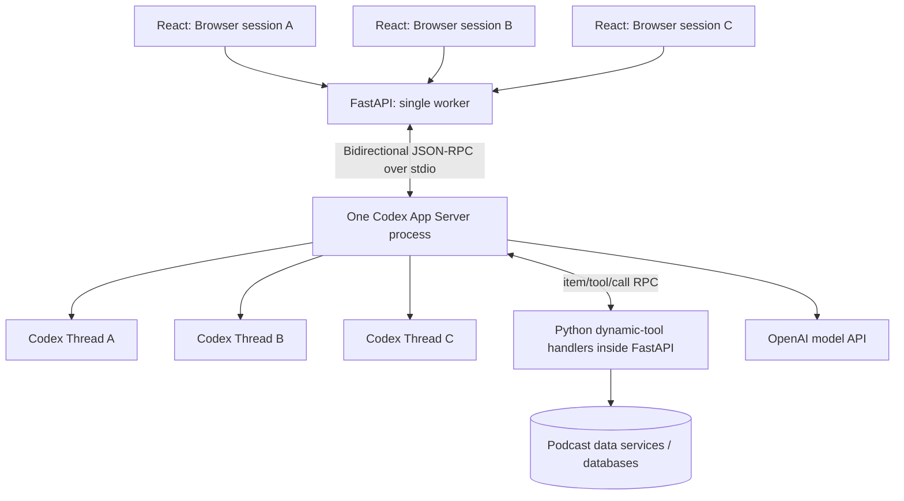

# Agent Harness Design

**Project:** Podcast Analyst Agent  
**Status:** Accepted v0 design  
**Last updated:** 2026-11-07

> Spend complexity where it creates product value, not where it merely creates infrastructure.

## 1. Overview

The application's core agent runtime is **Codex App Server** (`codex app-server`, implemented in `codex-rs`). Our **FastAPI** backend manages a single long-lived Codex subprocess and communicates with it over **bidirectional, newline-delimited JSON-RPC on stdin/stdout**. The React frontend never communicates with Codex directly.

This architecture is deliberately optimized for a small, private demo with **fewer than four simultaneous users**. We want to spend engineering effort on podcast transcripts, claims, evidence, the knowledge graph, and agent behavior—not on infrastructure.



Codex persists threads to the EC2 instance's local filesystem, which means they'll live on our EBS volume if that filesystem is backed by EBS.

The app explicitly sets the child's `CODEX_HOME`: locally it defaults to
`.local/codex/`; Compose sets `PODCAST_CODEX_HOME=/var/lib/podcast-analyst/codex`
and bind-mounts that host path. Repository-managed configuration is installed
before Codex starts; see [configuration management](local_codex_chat.md#git-managed-codex-configuration).

Assuming /var/lib is on our EBS-backed filesystem, this gives us:
- Persistence across FastAPI and Codex process restarts.
- Persistence across EC2 stop/start cycles.
- Persistence across instance replacement only if we reattach retained storage;
  the current root EBS volume is deleted on termination.
We should verify the backing volume with findmnt -T /var/lib/podcast-analyst/codex.

**Principle:** One **Codex process** per FastAPI worker, **one Codex thread** per browser/app session, **one active turn** per thread. Different users' threads may run concurrently.

## 2. Decisions

| Area | Decision |
| --- | --- |
| Deployment | One EC2 instance, one Uvicorn worker, one FastAPI process |
| Agent runtime | One long-lived `codex app-server` subprocess started during FastAPI lifespan startup |
| Transport | JSON-RPC-like protocol over the subprocess's stdin/stdout; one JSON object per line |
| Browser sessions | New Codex `thread/start` when a user opens/initializes the app; no shared threads |
| User turns | HTTP requests trigger `turn/start` on that session's thread |
| Concurrency | Multiple threads allowed; reject a second simultaneous turn on the *same* thread |
| Server state | In-memory maps for RPC futures, session ownership, thread routing, turn state, and event subscribers |
| Streaming | Server-Sent Events (SSE) from FastAPI to React |
| Agent tools | **Codex dynamic tools**, implemented as normal Python handlers in the backend; **no MCP server** for v0 |
| Authentication | Password shared with test users ahead of time; FastAPI/Starlette keeps login state server-side; the browser cookie carries only an opaque session ID |
| Codex credentials | Backend-only `OPENAI_API_KEY`, loaded from local `.env` in development and provided to subprocess environment |
| Codex version | Use latest **stable** release when establishing the environment; pin the exact tested version for repeatable builds |
| Persistence | No application-side conversation history or session restoration for v0; opening a new app session creates a new thread |

As of **2026-11-07**, the latest stable release verified from the official Codex releases page was **`0.167.0`**; newer stable versions should be adopted deliberately and tested, not silently pulled into existing deployments.

## 3. Responsibilities

### FastAPI owns

- Shared-password login and browser sessions.
- Session ownership checks on every session/turn/events endpoint.
- The Codex child process and its lifecycle.
- JSON-RPC request serialization, IDs, response matching, and timeouts.
- Notification routing, per-session event buffers, and SSE delivery.
- Turn admission (a per-session busy guard) and user interruption.
- Dispatch and execution of our Python dynamic-tool handlers.
- Application-specific data access and observability.

### Codex App Server owns

- Agent threads, turns, context/history, and model interaction.
- Agent reasoning/tool orchestration and its execution lifecycle.
- Emitting item/turn progress events.
- Requesting dynamic-tool execution from its client (FastAPI).
- Its own sandbox and approval machinery (which must be configured conservatively).

### React owns

- Login, chat display, user prompt submission, streaming status, and interrupt button.
- An app session identifier supplied by FastAPI; **not** arbitrary Codex thread IDs.
- Rendering agent events sent by FastAPI—not parsing or writing JSON-RPC itself.

## 4. Process lifecycle

1. FastAPI starts through its **lifespan** handler.
2. Load environment variables and verify `OPENAI_API_KEY` is present.
3. Spawn `codex app-server` with `asyncio.create_subprocess_exec`, piping stdin, stdout, and stderr.
4. Start a **single continuous stdout reader task** and a separate stderr drain/logging task.
5. Send `initialize`, await its response, then send the `initialized` notification. Include `capabilities.experimentalApi: true` to support dynamic tools.
6. Mark the harness ready; accept application traffic.
7. On graceful shutdown, stop admitting new turns, best-effort interrupt or drain active work, terminate the child, and fail outstanding RPC futures/streams cleanly.

If Codex crashes, the backend becomes temporarily **unready**, rejects new turns, fails pending operations, and can restart the child **with a fresh RPC connection**. Existing in-memory sessions should be invalidated for v0; clients start new sessions after reconnection. Avoid automatically replaying `turn/start` because its previous execution status may be unknown.

**Important:** `uvicorn --workers 4` would start four FastAPI lifespans and potentially four Codex subprocesses. Run **one worker** in the initial deployment. Also avoid running production with auto-reload.

### Handshake example

Each line below is an independent JSON object, and the subsequent request is sent after the prior request's response:

```json
{"id":1,"method":"initialize","params":{"clientInfo":{"name":"podcast_analyst","title":"Podcast Analyst","version":"0.1.0"},"capabilities":{"experimentalApi":true}}}
```

```json
{"method":"initialized","params":{}}
```

This protocol intentionally does **not** require the standard JSON-RPC `"jsonrpc":"2.0"` field. Request messages have `id`/`method`/`params`; responses have `id`/`result` or `id`/`error`; notifications have `method`/`params` but no `id`.

## 5. Session and turn lifecycle

### Opening the app

Once the browser has a valid FastAPI login session:

1. React calls `POST /api/sessions`.
2. FastAPI submits `thread/start` to the shared Codex subprocess.
3. Codex returns `result.thread.id`.
4. FastAPI generates a **random opaque app-session ID** and stores its ownership and Codex `thread_id`.
5. FastAPI returns only the app-session ID to React.
6. React connects to that session's SSE endpoint before submitting its first turn.

Example `thread/start` (future dynamic-tool definitions will be added to `dynamicTools`):

```json
{"id":2,"method":"thread/start","params":{"cwd":"/srv/podcast-analyst/agent-workspace","approvalPolicy":"never","sandbox":"read-only","dynamicTools":[]}}
```

The filesystem path is illustrative and must exist on the deployment host. Chat threads now advertise the research tools described in [section 8](#8-dynamic-tools-no-mcp-server). The `dynamicTools` field requires experimental API opt-in.

### Asking a question

1. React sends `POST /api/sessions/{session_id}/turns` with the prompt.
2. FastAPI authorizes the browser session, atomically claims the thread's **not-busy → busy** transition, and submits `turn/start`.
3. Codex responds to that JSON-RPC request with a turn record, while agent progress continues through **asynchronous notifications**.
4. FastAPI forwards relevant notifications to the user's SSE stream.
5. On `turn/completed`, FastAPI releases the thread busy guard and marks the turn finished (including `failed`/`interrupted` outcomes).

```json
{"id":3,"method":"turn/start","params":{"threadId":"thr_example","input":[{"type":"text","text":"What were the strongest claims in this episode?"}]}}
```

`turn/start` **acceptance is not completion**. `turn/completed` is the terminal event. It may arrive interleaved with other threads' notifications and other requests' responses.

**v0 rule:** A second turn on the same session while its first is still active returns **HTTP 409 Conflict**. A different user's session can submit and execute concurrently. We intentionally do not support `turn/steer`, multi-tab shared threads, or multiple writers to one thread in v0.

### Interrupting

`POST /api/sessions/{session_id}/interrupt` forwards `turn/interrupt` with the active `threadId` **and** `turnId`. Do not clear the busy flag merely because the interrupt RPC was accepted; wait for terminal turn state (or explicitly reconcile an error/disconnection).

## 6. In-memory state and correlation IDs

The runtime must distinguish **three identities**:

| Identifier | Scope / purpose |
| --- | --- |
| **App session ID** | Random browser-facing identifier, bound to an authenticated browser session |
| **JSON-RPC request ID** | Local outbound request correlation, e.g. `id=42` → pending `asyncio.Future`; not a turn ID |
| **Codex thread ID / turn ID** | Returned by Codex; used for routing notifications, tracking active work, and interruptions |

Suggested internal structures (illustrative):

```python
@dataclass
class SessionState:
    owner_session_id: str        # Identifier from our authenticated cookie/session
    codex_thread_id: str
    active_turn_id: str | None = None
    busy: bool = False
    # Plus a lock, short bounded event replay buffer, and SSE subscribers.

pending_requests: dict[int | str, asyncio.Future]
sessions: dict[str, SessionState]       # app_session_id -> state
thread_to_session: dict[str, str]       # codex_thread_id -> app_session_id
```

**Dispatcher responsibilities:**

- **Response** (`id` plus `result`/`error`, no `method`) → look up `pending_requests[id]` and resolve/reject that Future.
- **Notification** (`method`, no `id`) → route by `params.threadId` or the relevant nested thread field; append to the session's bounded replay buffer and publish to SSE subscribers.
- **Server-originated request** (`method` **and** `id`) → dispatch a handler asynchronously and send a matching JSON-RPC response to Codex; do **not** block the stdout reader while the handler runs.

RPC IDs only correlate request/reply envelopes. Thread IDs identify conversations; turn IDs identify individual executions. A `turn/start` notification may arrive before the RPC response, so create the session's routing/buffer state **before** submitting turns and permit early events to arrive by thread ID.

Use one locked writer for **all** messages to child stdin, including responses to Codex-originated requests, to avoid interleaving JSON lines. The stdout reader runs continuously, independently of HTTP requests or tool execution. Drain stderr independently: **never parse stderr as JSON-RPC**.

### Event streaming

Prefer one active SSE connection per app session for v0. Buffer a small number of recent events so immediate Codex notifications are not lost while the browser connects. Send application event IDs (or sequence numbers) to support basic reconnect/replay later; cap queue sizes so a disconnected/slow browser cannot consume unbounded memory.

Most useful notifications include:

| Notification | UI behavior |
| --- | --- |
| `turn/started` | Show active/working state |
| `item/agentMessage/delta` | Append streaming assistant text |
| `item/started` | Show activity/tool start, if relevant |
| `item/completed` | Record authoritative completed item |
| `turn/completed` | Mark success/failure/interruption; release busy guard |

**Do not append an item's completed full text after already appending its deltas.** Treat the completed item as authoritative state/reconciliation, not another delta.

## 7. FastAPI surface

| Endpoint | Purpose |
| --- | --- |
| `POST /api/login` | Check the pre-shared password, create a server-side login session, and set an opaque session-ID cookie |
| `POST /api/logout` | Invalidate the server-side login session and clear its cookie |
| `POST /api/sessions` | Start a new Codex thread and return an app session ID |
| `POST /api/sessions/{id}/turns` | Submit prompt using `turn/start`; return accepted turn metadata |
| `GET /api/sessions/{id}/events` | Stream session's agent notifications using SSE |
| `POST /api/sessions/{id}/interrupt` | Interrupt its active turn |
| `GET /health` | Process liveness |
| `GET /ready` | Harness initialized and ready to serve new requests |

Every session-scoped endpoint checks **both** login authorization and session ownership. A shared login password authorizes access to the app, but does **not** authorize a browser to access another visitor's thread.

For the single-worker demo, a small in-memory login-session store is sufficient;
restarting the backend signs users out. The cookie is an opaque identifier, not
the password or an authorization-claims payload. Validate the server-side record
and expiry on every protected UI/API request. `SessionMiddleware` alone stores
signed session data in the cookie; using it as a signing helper still requires
our server-side store. Password login and ownership checks are included in the beta deployment.

## 8. Dynamic tools (no MCP server)

We will implement business-specific tools later as **ordinary Python handlers inside FastAPI**. Each thread advertises tool definitions through the `dynamicTools` property of `thread/start`. `initialize.params.capabilities.experimentalApi` must be set to `true`.

Illustrative future tool declaration (not yet implemented):

```json
{
  "type": "function",
  "name": "search_transcripts",
  "description": "Search indexed podcast transcript passages for relevant evidence.",
  "inputSchema": {
    "type": "object",
    "properties": {"query": {"type": "string"}},
    "required": ["query"],
    "additionalProperties": false
  }
}
```

When Codex calls it, it sends a **server-originated JSON-RPC request**:

```json
{"id":60,"method":"item/tool/call","params":{"threadId":"thr_example","turnId":"turn_example","callId":"call_example","tool":"search_transcripts","arguments":{"query":"electric vehicle claims"}}}
```

FastAPI validates the requested tool, validates arguments, runs the Python handler in an independent task (and offloads blocking work if necessary), and returns a response **using that incoming JSON-RPC request ID**:

```json
{"id":60,"result":{"contentItems":[{"type":"inputText","text":"Found three relevant passages with source references."}],"success":true}}
```

Do not confuse Codex's `callId` with the JSON-RPC `id` used to answer the request. For execution failures, follow the generated schema's error/success conventions and provide a short safe error result without leaking secrets.

**Implemented tools.** Definitions live in Git as `codex/tools/<name>.json` and are loaded with
`codex_config.tool_specs()`. Handlers are thin pass-throughs to the database clients:

| Tool | Threads | Handler |
| --- | --- | --- |
| `vector_search(query, limit=5)` | chat | `AgentTools` → `EmbeddingClient.embed` → `PostgresClient.vector_search` (pgvector cosine; returns passage text plus podcast, episode, date, URL) |
| `graph_query(cypher)` | chat | `AgentTools` → `GraphClient.read_only_query` (one prepared statement in a read-only Ladybug transaction) |
| `postgres_database_query(sql)` | chat, claim extraction | `AgentTools` → `PostgresClient.read_only_query` (SELECT-only role, `READ ONLY` transaction, one statement) |
| `write_claim(...)` | claim extraction only | `ClaimExtractor.write_claim` (see [etl_design.md](etl_design.md)) |
| `add_thesis(description, entities)` | chat | `AgentTools.add_thesis` → `PostgresClient.add_thesis` (thesis + `thesis_entities`, one transaction) → `GraphClient.project_thesis` (`(Thesis)-[:ABOUT]->(Entity)`). Its description tells Codex to ask follow-up questions about a vague stance ("I'm bullish on AMZN") and to save a specific thesis immediately; a blank description or no entities is refused. |

`add_thesis` is the chat agent's only write tool. `AgentTools.call` serializes results to JSON and caps them at 200 rows / 40,000 characters.
A handler exception is returned to the model as a failed tool result so it can correct itself.

Dynamic tools are **experimental**, even when Codex itself is a stable release. We accept that tradeoff to avoid a separate MCP service for a small demonstration app.

## 9. Security and operational guardrails

- Keep `OPENAI_API_KEY` only on the backend. `.env` must be gitignored; load values explicitly at process startup and provide them to the Codex child's environment. Never log keys or send them to React.
- Use HTTPS in deployment; set session cookies `HttpOnly`, `Secure`, and an appropriate `SameSite` policy. Use a long random signing/session secret; do not use the shared password itself as the cookie identifier.
- A visitor must only be able to address **their own** app session. Do not expose an endpoint that accepts arbitrary Codex `threadId` values.
- Use a dedicated low-privilege OS user and a restricted working directory for the Codex process. Prefer `sandbox: "read-only"` and `approvalPolicy: "never"` for this research-only demo; verify behavior against the installed release and fail closed on unexpected approval requests.
- Code-execution/file capabilities require explicit trust boundaries. Codex's sandbox configuration should not be treated as a substitute for OS/container isolation or restricting available secrets.
- Add small timeouts and limits: request timeout, tool timeout, max input size, limited active sessions, bounded SSE event buffers, and conservative per-session rate limits.
- Unexpected server-originated requests must receive a deterministic safe error/decline rather than silently hanging the Codex turn.
- Distinguish error classes: RPC failure, agent turn failure, subprocess failure, tool failure, browser disconnect, and interrupted turn.
- Log method, request ID, app-session ID (or safe hash), thread ID, turn ID, duration, and status. Avoid logging sensitive prompt content or tool output by default.
- Validate API-key-backed Codex authentication and relevant terms for our hosted use before exposing the demo; do not assume that a personal ChatGPT login should be shared by backend users.

## 10. Versioning and schema verification

Initial pin (latest stable verified on 2026-11-07):

```bash
npm install -g @openai/codex@0.167.0
codex --version
codex app-server generate-json-schema --out ./schemas
```

The deployment should pin the version explicitly (for example, in the Docker image or EC2 bootstrap manifest). Generated schemas should match the **installed** Codex version. On a version upgrade, run the RPC and concurrency integration tests before deploying.

## 11. Implementation plan

### Phase A — Minimum vertical slice

1. Implement `CodexAppServerClient` startup/shutdown and the initialize handshake.
2. Implement the continuously running stdout dispatcher, locked stdin writer, stderr drain, and `pending_requests` Future map.
3. Implement `POST /api/sessions` → Codex `thread/start`.
4. Implement `POST /api/sessions/{id}/turns` → Codex `turn/start` and per-session busy guard.
5. Implement SSE notification streaming and terminal-turn reconciliation.
6. Render one question/answer in React with a new thread on app opening. The front end's chat interface should be intentionally minimal at this point - just a text input box, the agent's response and the user's messages shown in a typical 'imessage' like setup. We'll add bells and whistles later. 

### Phase B — Robustness before inviting friends

1. Session ownership enforcement; cookie/password auth.
2. `turn/interrupt`, timeouts, crash handling, bounded event buffers, health/readiness endpoints.
3. Three-user concurrency and event-routing tests.
4. Dynamic-tool RPC dispatcher, including handling unexpected server requests safely.

### Phase C — Research-specific features (later)

Define dynamic tools for transcript search, claims, evidence retrieval, and knowledge-graph traversal. Tool implementation and database design are separate documents.

## 12. Acceptance tests

- [ ] Startup creates **exactly one** Codex subprocess and performs initialization once.
- [ ] Three browser sessions produce three distinct Codex threads.
- [ ] Three users can run turns concurrently without cross-contamination of output or events.
- [ ] Out-of-order RPC responses resolve the **correct** Future by ID.
- [ ] Notifications arriving before `turn/start` response are retained and delivered to the correct session.
- [ ] Second turn submitted to a busy thread returns `409`; other threads remain usable.
- [ ] `turn/completed` (success, failure, or interruption) releases the correct busy guard.
- [ ] A simulated `item/tool/call` request is answered on stdin without blocking the stdout reader.
- [ ] An unauthorized visitor cannot read, interrupt, or submit a turn to another visitor's session.
- [ ] Browser SSE disconnect does not terminate unrelated agent turns; buffers remain bounded.
- [ ] Codex crash fails pending requests, changes readiness, and leaves no falsely successful turns.
- [ ] Shutdown leaves no orphaned child process.

## 13. Explicit non-goals for v0

- Multiple FastAPI/Uvicorn workers, distributed session stores, or multi-instance Codex orchestration.
- Shared threads, multi-tab synchronized writers, or several users editing one conversation.
- Persistent application chat history or resuming browser sessions after restart.
- A separate MCP server or generalized plugin framework.
- An advanced approval UI or arbitrary shell/file operations initiated by users.
- A sophisticated process supervisor, message broker, or WebSocket layer where simpler asyncio + SSE suffices.

## References

- [Codex App Server documentation](https://learn.chatgpt.com/docs/app-server)
- [Codex releases](https://github.com/openai/codex/releases)
- [Codex app-server implementation](https://github.com/openai/codex/tree/main/codex-rs/app-server)
- [Codex app-server protocol types](https://github.com/openai/codex/tree/main/codex-rs/app-server-protocol)
- [Codex core agent runtime](https://github.com/openai/codex/tree/main/codex-rs/core)
- [JSON-RPC message structs in codex-rs](https://github.com/openai/codex/blob/rust-v0.167.0/codex-rs/app-server-protocol/src/rpc.rs)
- [Dynamic-tool type definitions](https://github.com/openai/codex/blob/rust-v0.167.0/codex-rs/protocol/src/dynamic_tools.rs)

---

**Summary:** FastAPI supervises one Codex agent runtime, gives each browser an isolated thread, correlates JSON-RPC requests and agent events, bridges execution to React over SSE, and handles future domain tools directly in Python. Build the smallest reliable vertical slice first; add complexity only when it produces product value. 1 uvicorn worker means we only deal with 1 codex instance under the hood. 
